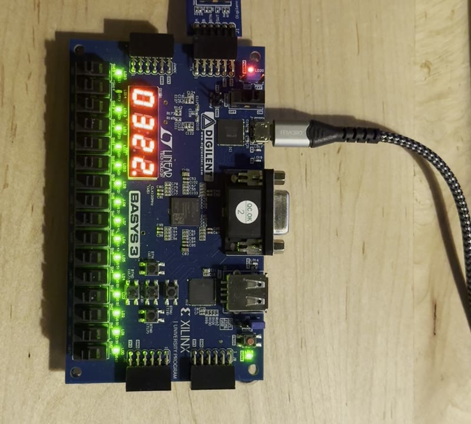
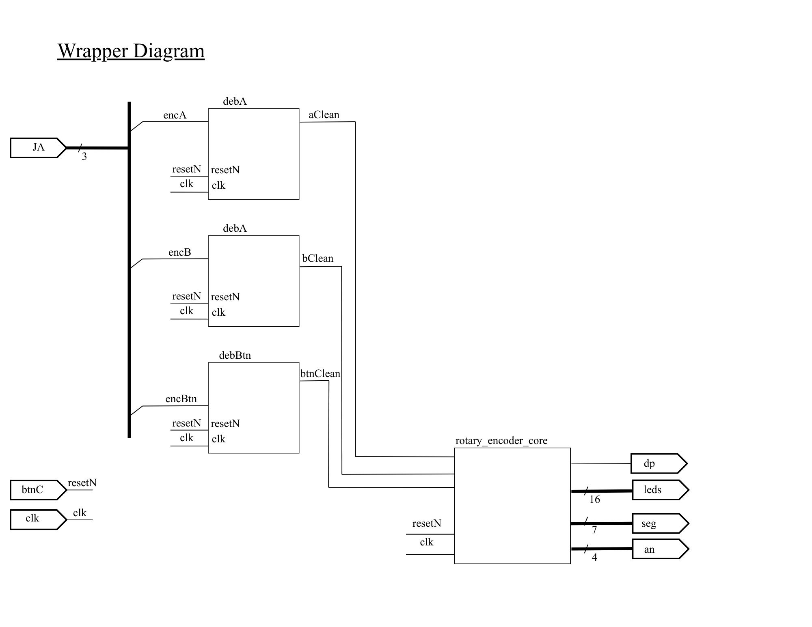
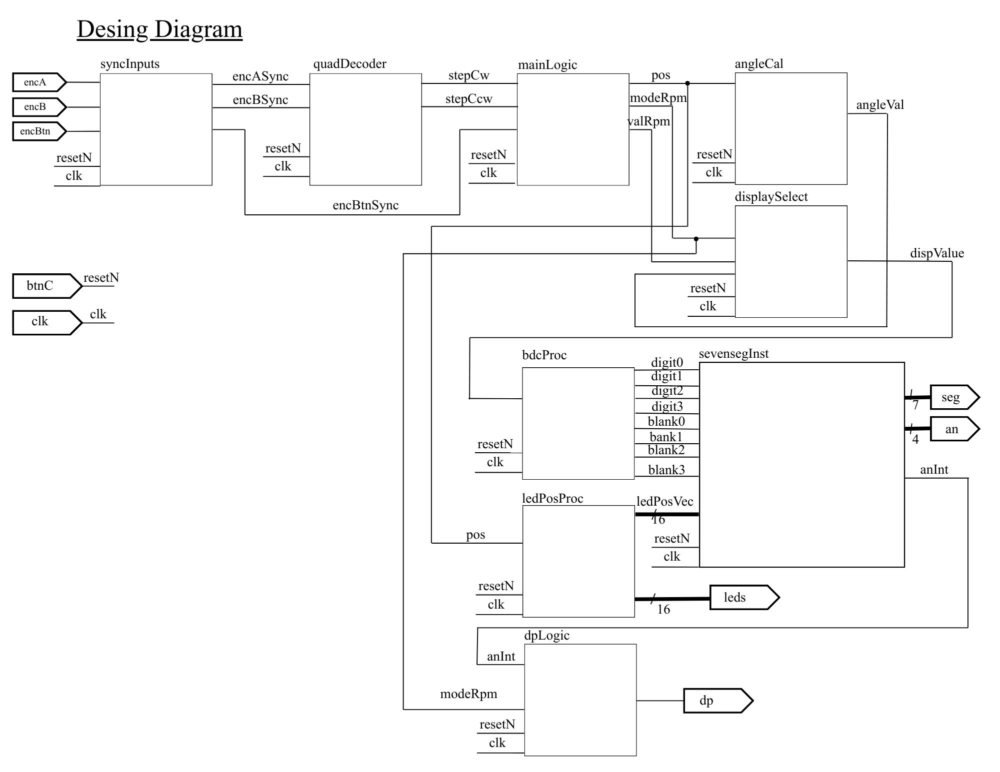
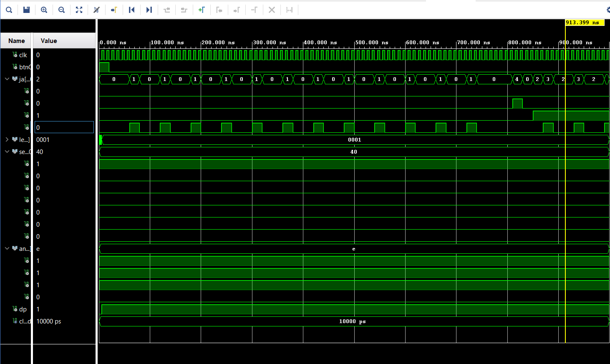

# FPGA Rotary-Encoder Interface (VHDL, Basys-3)

A synchronous VHDL design for a Digilent Basys-3 (Artix-7) that reads a PmodENC rotary encoder. Each detent moves one LED along the 16-LED bar, and the four-digit seven-segment display shows either the shaft **angle** or the **RPM**, selected by pressing the encoder's button. The active mode is shown by the LED pattern (one LED lit for RPM, all but one for angle) and by which decimal point is lit.

Solo project for CPE 3020 (VHDL Design with FPGAs), Kennesaw State University, Fall 2025.

*Frame from the author's demo video of the design running on a Basys-3 with a PmodENC.*

## Engineering problem

Mechanical encoders produce noisy, asynchronous signals. The design has to bring them safely into a 100 MHz clock domain, decode direction and steps without false counts, and turn the result into a usable display, all in synchronous logic.

## Architecture

| Block | File | Role |
|---|---|---|
| `basys3_top` | `src/basys3_top.vhd` | Board wrapper. Inverts `btnC` into an active-low reset and instantiates three `debounce` blocks |
| `rotary_encoder_core` | `src/rotary_encoder_core.vhd` | Synchronizers, quadrature decoder, position/RPM/mode logic, BCD conversion, LED and decimal-point control |
| `basys3_rotary_top_TB` | `sim/basys3_rotary_top_TB.vhd` | Testbench: 12 clockwise steps, a button press, 12 counter-clockwise steps |
| `debounce`, `SevenSegmentDriver` | **not in this repository** | Course-provided components, not the author's work (see [What is missing](#what-is-missing)) |

### Signal path

1. **Debounce** (course component with generic `COUNT_MAX`): encoder A and B use `COUNT_MAX = 5000` (50 µs at 100 MHz) and the push-button uses `200000` (2 ms).
2. **Two-flip-flop synchronizers** on A, B and the button bring them into the clock domain and limit metastability.
3. **Quadrature decode, one step per detent:** on a rising edge of A, B = 0 means clockwise and B = 1 means counter-clockwise. Only A's rising edge is used (1× decoding).
4. **Position** is a 4-bit counter (0–15) with wrap-around in both directions, shown as a one-hot LED.
5. **RPM** counts steps in a 0.5 s window (50 000 000 clock cycles) and reports `ticks × 8`.
6. **Angle** is `position × 23`.
7. **Display** value is converted to four BCD digits for the seven-segment driver. A button rising edge toggles the mode.

## Observations from reading the design

- **Scale factors.** The angle step of 23° approximates 360°/16 = 22.5°, so the displayed angle at position 15 is 345° instead of 337.5° (7.5° high). For RPM, steps per 0.5 s × 2 × 60 / 16 gives a factor of 7.5, while the code uses 8, about 6.7 % high. These are rounding choices made to keep integer arithmetic. They assume 16 steps per revolution, which is not documented in the sources. The physical encoder was not measured.
- **Single-edge decode.** Using only A's rising edge is robust and simple, but it ignores half of the information in the quadrature signal and cannot detect a missed edge.
- **Mode on reset.** The design starts in RPM mode (`modeRpm = '1'`).

## Verification evidence

| Evidence | What it shows |
|---|---|
| Demo video (not in repo, 71 s) | The LED bar and display responding to the encoder on a Basys-3 |
| Demo video 2 (not in repo, 37 s) | The Vivado simulation being set up and run |
| `docs/vivado_testbench_waveform.png` | Vivado waveform of the testbench |

**Reading the waveform correctly.** The window shown ends at about 913 ns. The testbench pulses are 20 ns wide, but the debounce blocks require the input to be stable for 50 µs (5000 cycles at 10 ns), so in this window the debounced signals, `leds` (`0001`) and `seg` do not change. The waveform therefore shows the stimulus, not the design's response. The simulation was not re-run for this repository: Vivado was not available and the two missing components are required. A testbench with pulses well beyond 50 µs (and a button press beyond 2 ms) would exercise the full path. This is the first improvement to make before relying on the simulation as evidence.

The functional evidence for this project is the hardware demo.

## What is missing

- `debounce.vhd` and `SevenSegmentDriver.vhd`: provided by the course and not in the author's files. The project cannot be synthesised from this repository alone. Drop the two files into `src/` (if the course licence permits redistribution) or replace them with equivalent modules.
- The Basys-3 constraints file (`.xdc`). The pin table below comes from the original repo notes. Verify it against Digilent's master XDC.

| Signal | Pin | Description |
|---|---|---|
| `clk` | W5 | 100 MHz board clock |
| `btnC` | U18 | Centre button, used as reset |
| `JA(0)` | J1 | PmodENC A |
| `JA(1)` | L2 | PmodENC B |
| `JA(2)` | J2 | PmodENC button |

## Tools

Vivado (the Fall 2025 project was built and simulated with it), Digilent Basys-3, Digilent PmodENC.

## Lessons learned

- Synchronize first, then detect edges: edge detection on an unsynchronised input is where false counts come from.
- Choosing debounce times per signal (fast for encoder lines, slower for the button) matches each signal's noise.
- A testbench has to run longer than the slowest time constant in the design, or it shows nothing.

## Future work

- Longer, self-checking testbench with assertions on `pos`, mode and `leds`.
- Full 4× quadrature decoding and a direction-validity check.
- Exact RPM/angle scaling from the encoder's real steps per revolution.
- Add a constraints file and a build script (Vivado batch mode).

## Provenance

Author's own VHDL for the core, wrapper and testbench, matching the graded Fall 2025 report; comment headers were reformatted for this repository. `debounce` and `SevenSegmentDriver` were provided by the course (CPE 3020, Prof. Scott Tippens) and are not the author's work. The author's contribution is the wrapper, the core logic (synchronizers, quadrature decoder, position/RPM/mode logic, BCD conversion, LED and decimal-point control) and the testbench, plus choosing the debounce time constants (`COUNT_MAX`).

## Preparation note

The VHDL (`src/`, `sim/`) and the two diagrams are the author's own coursework. This README and the analysis in it were produced during portfolio preparation with AI assistance (Claude).

## License

MIT for the author's files (`LICENSE`).
